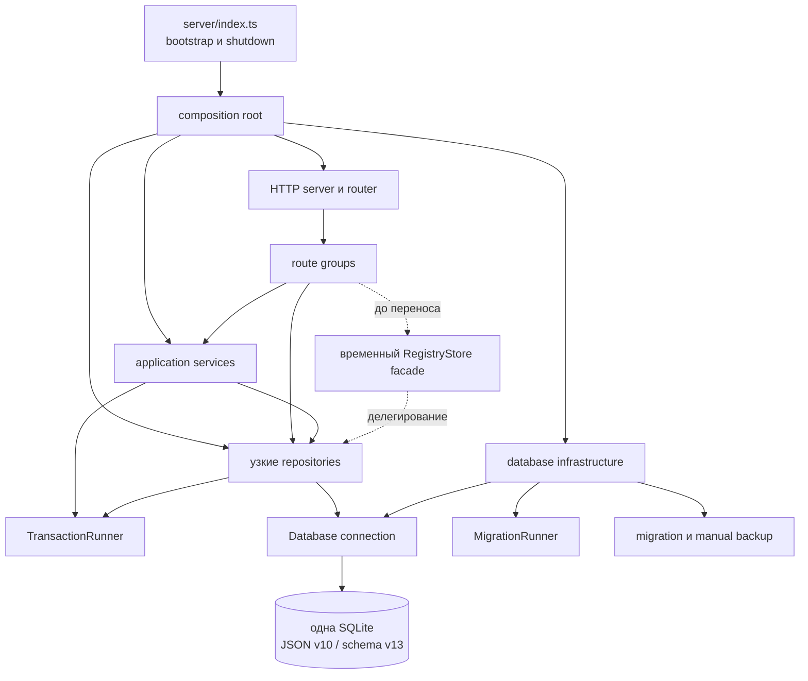

# ADR-0010: модульная серверная архитектура и разделение RegistryStore

Дата решения: 25.10.2026; исходное предложение — 24.10.2026. Статус: **реализовано; #135/А4 приняты владельцем 27.10.2026**. Уточняет серверную часть ADR-0006. Реализация выполнена отдельными совместимыми PR после #134; [свидетельства завершения](../refactoring/server-god-object-plan.md#фиксация-завершения-а4--27102026). Описание контекста и последовательности ниже сохраняет исходное обоснование.

## Контекст

Серверная часть локального редактора построена на Node.js, TypeScript и одной SQLite. Текущее решение обеспечивает важные свойства продукта:

- автономную работу на одном компьютере;
- одну локальную базу;
- версионирование проектов, ПУ-66 и изображений знаков;
- optimistic concurrency через ожидаемую редакцию или версию;
- `BEGIN IMMEDIATE` для согласованных изменений;
- резервную копию перед миграцией;
- восстановление старых форматов;
- неизменяемые исторические снимки;
- локальный HTTP API для интерфейса.

При этом `server/store.ts` превратился в God Object. `RegistryStore` одновременно открывает базу, выполняет миграции, создаёт резервные копии и обслуживает проекты, recovery, ПУ-66, каталог знаков, нормативные документы, подтверждения параметров и legacy-реестры.

`server/index.ts` образует второе узкое место. Один обработчик выполняет проверку запросов, разбор URL, маршрутизацию, валидацию, вызов сценариев, формирование JSON и бинарных ответов, отображение ошибок, диагностику, раздачу статических файлов, запуск и остановку сервера.

Проблема заключается не только в размере файлов. Эти компоненты имеют слишком много независимых причин изменения:

- новая версия SQLite изменяет `RegistryStore`;
- изменение правил recovery изменяет тот же класс;
- развитие ПУ-66 и знаков изменяет тот же класс;
- добавление маршрута расширяет общий `if/else`;
- изменение ошибки или бинарного ответа затрагивает общий обработчик;
- тесты вынуждены поднимать более широкий объект, чем требуется сценарию.

ADR-0006 уже принимает модульный монолит, узкие интерфейсы прикладных сценариев, общую SQLite и постепенное разделение `RegistryStore`. Настоящий ADR уточняет серверные границы, порядок зависимостей и ограничения перехода.

## Критерии решения

Решение должно:

1. сохранить одну SQLite и существующую модель локального приложения;
2. сохранить атомарность межтабличных операций;
3. не менять JSON v10, SQLite v13, URL, payload и status codes в структурных PR;
4. обеспечить поэтапное внедрение с небольшими обратимыми PR;
5. разделить причины изменения хранения и транспорта;
6. не вводить инфраструктуру, не оправданную текущими сценариями;
7. позволить тестировать миграции, репозитории и маршруты независимо;
8. сохранить совместимость на всём переходном периоде;
9. оставить предметные операции выразительными, а не сводить их к универсальному CRUD;
10. не препятствовать последующему выделению bounded contexts, если появятся разные модели и правила согласованности.

## Решение

**Сервер остаётся модульным монолитом с одной SQLite. `RegistryStore` постепенно разделяется на инфраструктуру базы, предметно ориентированные репозитории и прикладные сервисы. `server/index.ts` постепенно превращается в composition root и bootstrap.**

### 1. Единая SQLite сохраняется

Проекты, recovery, ПУ-66, знаки, нормативные документы и подтверждения продолжают храниться в одной базе. Разделение кода не означает деление базы, процессов или транзакций.

Одна база необходима для существующих атомарных операций:

- проект и новая историческая редакция;
- recovery и ссылка на исходный JSON;
- импорт ПУ-66 и возврат ранее исключённых карточек;
- партия знаков, активный каталог и исторические PNG;
- удаление документа после проверки ссылок из других модулей.

### 2. Инфраструктура базы отделяется от предметных репозиториев

Отдельные компоненты владеют:

- открытием и закрытием SQLite;
- проверкой прав файла;
- `PRAGMA foreign_keys`;
- версией схемы;
- миграциями;
- копией перед миграцией;
- ручными резервными копиями;
- выполнением транзакций;
- временем.

Предметные репозитории не выполняют миграции и не создают резервные копии.

Рекомендуемые контракты:

```ts
export interface Clock {
  nowIso(): string
  nowEpochMs(): number
}

export interface TransactionRunner {
  immediate<T>(operation: () => T): T
  deferred<T>(operation: () => T): T
}

export interface DatabaseBackupService {
  readonly directory: string
  createManualBackup(): Promise<string>
}

export interface MigrationBackupService {
  createBeforeMigration(currentVersion: number): string | null
}
```

`VACUUM` и другие SQLite-операции с особыми транзакционными требованиями не скрываются за универсальным wrapper, если это изменяет текущее поведение.

### 3. Миграции становятся последовательными модулями

Каждый переход схемы оформляется как отдельная миграция с явно указанными исходной и целевой версиями.

```ts
export interface Migration {
  readonly from: number
  readonly to: number
  readonly name: string
  run(context: MigrationContext): void
}
```

Migration runner:

1. читает `PRAGMA user_version`;
2. отклоняет неизвестную будущую версию без изменения файла;
3. создаёт обязательную копию;
4. выполняет допустимую последовательность миграций;
5. проверяет достигнутую версию;
6. возвращает сведения для уведомления пользователя.

Специальное поведение миграции SQLite v2, включая `VACUUM` вне транзакции и отказ от обычной миграционной копии, сохраняется дословно до отдельного решения.

### 4. Хранение делится по предметным областям

Вместо одного store вводятся узкие серверные интерфейсы:

- `ProjectRepository`;
- `ProjectSourceStore`;
- `RecoveryRepository`;
- `LegacyRegistryRepository`;
- `Pu66Repository`;
- `Pu66KeyResolver`;
- `Pu66VerificationRepository`;
- `SignCatalogRepository`;
- `NormativeDocumentRepository`;
- `DocumentTextRepository`;
- `ParameterConfirmationRepository`.

Репозиторий владеет SQL своей области и преобразованием строк SQLite в соответствующие типы. Таблица сама по себе не образует репозиторий или bounded context. Например, карточки, редакции, источники, aliases, lifecycle и сверки остаются частями модуля ПУ-66.

### 5. Межмодульные операции оформляются прикладными сервисами

Если операция затрагивает несколько владельцев данных, её координирует application service, а не один расширенный репозиторий.

Примеры:

- `Pu66ImportService` координирует импорт карточек и возврат lifecycle;
- `Pu66LifecycleService` проверяет допустимые переходы и записывает события;
- `DeleteNormativeDocument` проверяет документы, amendments, партии знаков и подтверждения;
- recovery command boundary атомарно проверяет владельца, версию, source и запись.

Прикладной сервис получает узкие интерфейсы и `TransactionRunner`. Он не знает HTTP и не создаёт соединение с базой.

### 6. Recovery предоставляет атомарные команды

Низкоуровневые шаги вроде `assertRecoveryAvailable`, разрешения source и последующей записи не являются публичным API для маршрутов.

Маршрут передаёт одну команду:

```ts
export interface RecoveryRepository {
  list(): RecoverySummary[]
  get(sessionId: string, access?: RecoveryAccess): RecoveryRecord | null
  claim(command: ClaimRecovery): RecoveryRecord
  renew(command: RenewRecoveryLease): void
  release(command: ReleaseRecoveryLease): void
  save(command: SaveRecovery): RecoveryRecord
  delete(command: DeleteRecovery): void
}
```

Проверка владельца и `expectedVersion` остаётся внутри той же `BEGIN IMMEDIATE`, в которой выполняется изменение. Это решение реализуется только после стабилизации поведения #134.

### 7. HTTP делится на общий транспорт и группы маршрутов

Общие HTTP-компоненты владеют:

- Host и Origin;
- чтением JSON и ограничениями размера;
- JSON-ответами;
- security headers;
- разбором параметров пути;
- отображением ошибок;
- раздачей статических файлов;
- общей диагностикой запроса.

Маршруты группируются по областям:

- system и diagnostics;
- projects;
- recovery;
- ПУ-66;
- signs;
- documents и normative parameters;
- legacy registry.

Маршрут отвечает только за транспортный контракт:

1. распознать path, method и query;
2. прочитать и проверить body;
3. вызвать узкий сценарий;
4. сформировать ответ.

Маршрут не содержит SQL и не собирает атомарную операцию из нескольких низкоуровневых методов.

### 8. Composition root создаёт конкретные адаптеры

Конкретные SQLite-реализации создаются только в `composition-root.ts` или эквивалентном модуле.

```ts
const services = createServerServices(databasePath)
const router = createRouter(services)
const server = createHttpServer(router, services.diagnostics)
```

`server/index.ts` после завершения перехода отвечает за конфигурацию, создание зависимостей, `listen`, уведомление о миграции и graceful shutdown.

### 9. `RegistryStore` временно сохраняется как совместимый фасад

Во время перехода прежние публичные методы делегируют новым репозиториям. Это позволяет переносить хранение и маршруты разными PR.

```ts
export class RegistryStore {
  constructor(
    readonly projects: ProjectRepository,
    readonly recovery: RecoveryRepository,
    readonly signs: SignCatalogRepository,
  ) {}

  listProjects() {
    return this.projects.list()
  }
}
```

Forwarding method удаляется после того, как:

- новый контракт покрыт тестами;
- соответствующие маршруты переведены;
- другие модули не используют метод;
- поиск по репозиторию не находит обращений;
- полный E2E проходит.

После перехода фасад удаляется либо заменяется небольшим владельцем жизненного цикла `LocalDatabase`, если нужен единый `close()` и metadata базы.

## Направление зависимостей



Обязательные правила:

1. `server/index.ts` не знает SQL и предметные таблицы.
2. Route handlers не получают `DatabaseSync`.
3. Application services не знают HTTP.
4. Репозитории не знают route handlers и response formats.
5. Предметные репозитории не запускают миграции и backup.
6. Модули работают с одной SQLite через общий connection lifecycle.
7. Транзакционные границы определяются сценарием, а не расположением файлов.
8. Временный фасад не становится новым постоянным service locator.

## Порядок внедрения

Решение реализуется последовательно:

1. завершить и зафиксировать #134;
2. добавить server characterization и contract tests;
3. выделить connection lifecycle;
4. выделить migration backup;
5. выделить migration runner и миграции;
6. выделить ручной backup;
7. выделить `ProjectSourceStore`;
8. выделить `ProjectRepository`;
9. выделить `RecoveryRepository`;
10. выделить legacy registry;
11. выделить чтение и ключи ПУ-66;
12. выделить сверки, lifecycle и импорт ПУ-66;
13. выделить нормативные документы, текст и подтверждения;
14. оформить межмодульное удаление документа;
15. выделить каталог знаков;
16. собрать composition root;
17. выделить HTTP-примитивы и error mapper;
18. последовательно перенести группы маршрутов;
19. сделать `server/index.ts` тонким bootstrap;
20. удалить совместимый фасад.

Подробные критерии PR и тестовые матрицы описываются отдельным планом рефакторинга; ADR фиксирует направление и обязательные границы, а не заменяет план работ.

## Альтернативы

### Альтернатива 1. Оставить `RegistryStore` и разделить только файл

Можно перенести группы методов в extension-функции или вспомогательные файлы, оставив единый объект с доступом ко всем таблицам.

**Отклонено**, потому что это уменьшит размер файла, но не число причин изменения и не ширину зависимостей. Маршруты и тесты продолжат зависеть от универсального store.

### Альтернатива 2. Универсальный GenericRepository

Можно ввести `Repository<T>` с CRUD-операциями `find`, `save` и `delete`.

**Отклонено**, потому что основные операции проекта не являются универсальным CRUD: захват recovery, восстановление редакции, lifecycle ПУ-66, импорт партии знаков и подтверждение нормативного параметра имеют разные инварианты и транзакции.

### Альтернатива 3. ORM

Можно заменить прямой SQL ORM и разделять код через модели ORM.

**Отклонено для текущего этапа**, потому что ORM не устраняет смешение ответственности. Он также потребует заново подтвердить SQLite-специфичное поведение: `PRAGMA user_version`, `BEGIN IMMEDIATE`, JSON-функции, BLOB, `VACUUM INTO`, migration backup и historical revisions. Переход возможен только отдельным ADR с измеримой пользой.

### Альтернатива 4. Отдельная SQLite для каждого модуля

Можно физически разделить проекты, ПУ-66, знаки и документы.

**Отклонено**, потому что существующие сценарии используют межтабличную атомарность и ссылки между областями. Деление баз потребует распределённой координации или ослабления гарантий без текущей пользовательской потребности.

### Альтернатива 5. Микросервисы или отдельные процессы

Можно вынести предметные области в отдельные локальные сервисы.

**Отклонено**, потому что приложение локальное, однопользовательское и поставляется единым exe. Дополнительные процессы, протоколы, диагностика и управление версиями не окупаются текущими требованиями.

### Альтернатива 6. Полное переписывание сервера

Можно спроектировать новую структуру и переключить приложение после завершения.

**Отклонено**, потому что это создаёт длительную параллельную реализацию, усложняет сравнение поведения и повышает риск повреждения старых проектов и SQLite. Предпочтён постепенный strangler-подход через совместимый фасад.

### Альтернатива 7. DI-фреймворк

Можно использовать контейнер зависимостей для регистрации репозиториев и сервисов.

**Отклонено на текущем этапе**. Ручной composition root достаточен для имеющегося размера приложения и делает граф зависимостей явным. К решению можно вернуться при доказанной сложности ручной композиции.

## Последствия

### Положительные

- причины изменения распределяются между специализированными модулями;
- миграции можно проверять на каждой поддерживаемой версии SQLite;
- repository integration tests не требуют всего сервера;
- route contract tests не требуют знания SQL;
- атомарность становится явно привязана к прикладному сценарию;
- recovery перестаёт предоставлять вызывающему коду опасную последовательность низкоуровневых шагов;
- новые функции добавляются в соответствующий модуль, а не в общий store и общий `if/else`;
- уменьшается риск непреднамеренно изменить соседнюю область;
- серверная архитектура соответствует направлению ADR-0006.

### Отрицательные

- временно увеличится число файлов, интерфейсов и forwarding methods;
- часть SQL останется тесно связанной с SQLite;
- общая база означает, что некоторые application services всё равно знают несколько репозиториев;
- переход займёт серию PR и потребует параллельного сопровождения фасада;
- возможна ошибочная декомпозиция по таблицам вместо предметных сценариев;
- избыточно мелкие интерфейсы могут усложнить навигацию;
- миграционные fixture tests увеличат объём тестовых данных;
- уменьшение числа строк в `store.ts` само по себе не подтверждает завершение решения.

### Нейтральные и сознательные ограничения

- прямой SQL сохраняется;
- SQLite остаётся технологической зависимостью серверных адаптеров;
- application services не обязаны быть классами, если функция яснее выражает сценарий;
- не каждый модуль является bounded context;
- чтение может непосредственно использовать repository, если межмодульная координация не нужна;
- стабильные ошибки и HTTP-коды сохраняются до отдельного решения о контракте ошибок.

## Проверка решения

Каждый структурный PR должен проходить:

- `npm run check`;
- repository integration tests;
- server API contract tests;
- frozen JSON fixtures;
- frozen SQLite fixtures, если затрагивается база;
- SQLite concurrency tests, если затрагивается запись;
- полный E2E;
- Windows-проверку при изменении lifecycle, сна, файлов или сборки exe.

Извлечение модуля считается успешным не по уменьшению числа строк, а когда:

- маршрут зависит от узкого интерфейса;
- модуль владеет своими SQL и row mappers;
- межмодульная операция имеет явный application service;
- транзакция покрывает прежний набор изменений;
- старый forwarding method больше не нужен;
- публичное поведение осталось совместимым.

## Условия пересмотра

Решение пересматривается, если:

- появится несколько пользователей или сетевой сервер;
- несколько процессов должны одновременно писать одну базу;
- появится второй независимый клиент;
- потребуется синхронизация между устройствами;
- размер данных или профиль нагрузки перестанет соответствовать SQLite;
- появятся доказанные ограничения прямого SQL или ручного composition root;
- предметные области потребуют разных жизненных циклов, развертывания или моделей согласованности;
- восстановление и длительные операции потребуют фоновых очередей;
- требования безопасности потребуют аутентификации и авторизации.

При пересмотре новый ADR должен описать конкретный сценарий, измерения или инциденты, влияние на JSON и SQLite, план миграции, сохранение истории и стратегию отката.

## Связанные решения и документы

- [ADR-0001: локальное приложение](0001-local-application.md)
- [ADR-0002: проект и лист](0002-project-and-sheet.md)
- [ADR-0004: происхождение данных и правил](0004-data-and-rule-provenance.md)
- [ADR-0005: жизненный цикл ПУ-66](0005-pu66-lifecycle.md)
- [ADR-0006: предметные модули и независимые сценарии](0006-modular-application.md)
- [ADR-0007: основания решений](0007-decision-evidence.md)
- [ADR-0008: расстояние стойки](0008-post-distance.md)
- [План серверного рефакторинга](../refactoring/server-god-object-plan.md)
- [Контракты рефакторинга](../refactoring-contracts.md)
- [Архитектура](../architecture.md)
- [Дорожная карта](../../ROADMAP.md)
- GitHub #134: восстановление после сна и конкурирующего захвата
- GitHub #135: разделение `server/store.ts` и `server/index.ts`
