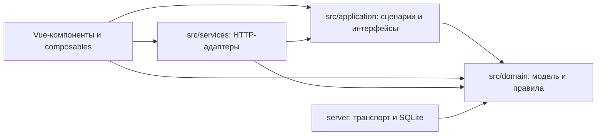

# Архитектура и границы платформы

Актуализировано 25.10.2026 по основной ветке `main`. Редактор работает локально для одного составителя: Vue / TypeScript, локальный Node.js API и SQLite, версии проектов, нормативные источники и лист A4. Согласование и совместная работа остаются запланированными. Первый запуск (#163) принят повторно на сборке № 28: 10/10. После независимого аудита перед продолжением функций 0.3.0 выполняется [первоочередной технический этап](refactoring/audit-2026-10-24.md); структурный перенос не меняет нормативную модель и форматы.

## Очередь технического этапа

#136, #134 и серверное разделение #135 завершены; архитектурный А4 принят владельцем 27.10.2026 после нового успешного Windows exe. Реализация [Pinia #191](refactoring/pinia-state-plan.md) включена через #228–#233; итоговая приёмка состояния остаётся отложенной. Сейчас выполняется [контроль архитектуры #184](refactoring/architecture-checker.md), затем #137, #138 и итоговая регрессия. До новых функций 0.3.0 погашается весь технический долг. И4 — отдельный интерфейсный этап.

Pinia 4.1.0 подключена одним createPinia в `src/main.ts`. Шесть stores владеют нормативными параметрами, кэшем статусов ПУ-66, документом/историей/восстановимым вводом, UI-проекцией сессии, навигацией и счётчиками каталогов. Основные представления [читают stores](refactoring/pinia-view-consumers.md), получая узкие объекты команд единственной корневой сессии. Прежние shallow refs, pending/dirty, одна recovery-очередь, async guards и DOM/browser lifecycle сохраняются. Локальные setup/формы остаются у прежних владельцев. Domain/application не импортируют Pinia или stores; это проверяют анализатор и ESLint. [ADR-0011](adr/0011-pinia-ui-state.md) и [карта перехода](refactoring/pinia-state-plan.md) отделяют готовность реализации от итоговой приёмки после технического этапа; Pinia не заменяет SQLite.

## Закреплённый архитектурный подход

**Модульный монолит с применением DDD к предметной модели и Clean Architecture к направлению зависимостей.** Эти положения уже приняты в [ADR-0006](adr/0006-modular-application.md); выбор локальной поставки закреплён в [ADR-0001](adr/0001-local-application.md). Это совместимые уровни решения: монолит описывает поставку и развёртывание, DDD — моделирование предметной области, Clean Architecture — организацию зависимостей. Они не являются тремя взаимоисключающими вариантами.

| Подход             | Что принято                                                                                | Что подтверждено кодом                                                                                                                                                  | Предел утверждения                                                                                                                                                           |
| ------------------ | ------------------------------------------------------------------------------------------ | ----------------------------------------------------------------------------------------------------------------------------------------------------------------------- | ---------------------------------------------------------------------------------------------------------------------------------------------------------------------------- |
| Модульный монолит  | Одна согласованно версионируемая поставка с внутренними границами и общей локальной SQLite | Клиент, локальный API, CLI и Windows exe находятся в одном репозитории; сценарии и адаптеры используют общую модель                                                     | Браузер и Node.js — разные процессы; это не набор независимо развёртываемых микросервисов. Все предметные области ещё не разделены на автономные модули                      |
| DDD                | Предметный язык, инварианты, происхождение решений, согласованность изменений              | `Scheme`, стойка с расстоянием, снимок ПУ-66, нормативное подтверждение; чистые функции правки и проверки, исторические основания и транзакционные операции             | Данные и функции — выбранная форма модели. Полная формализация bounded contexts и границ агрегатов, CQRS и Event Sourcing не объявлены реализованными                        |
| Clean Architecture | Ядро не зависит от Vue, DOM, клиентского HTTP и SQLite; сценарии задают узкие интерфейсы   | `src/domain`, `RecoverySession` / `RecoveryRepository`, `SaveProjectRevision` / `RestoreProjectRevision` / `ProjectRevisionRepository`, HTTP-адаптеры и проверки границ | Все сценарии ещё не вынесены из UI и хранилища. Это выполняемое правило для выделенного ядра и направление дальнейшего разделения, а не заявление о завершённой декомпозиции |

### Карта ответственности

| Часть                                                               | Ответственность и пример                                                                                                                                                |
| ------------------------------------------------------------------- | ----------------------------------------------------------------------------------------------------------------------------------------------------------------------- |
| [Предметная модель](../src/domain/model.ts)                         | Данные схемы и инварианты; [проверка схемы](../src/domain/review-scheme.ts), [основания решений](../src/domain/decision-evidence.ts) и правки работают без Vue и SQLite |
| [Прикладные сценарии](../src/application/project-revisions.ts)      | Сохранение и возврат версии; [восстановление](../src/application/recovery-session.ts) координирует очередь через интерфейс нужных операций                              |
| [Компоненты и composables](../src/composables/useProjectSession.ts) | Ввод, реактивное состояние, подтверждения, время жизни форм и применение результата к текущей сессии                                                                    |
| [Представление](../src/presentation/review/map-review-target.ts)    | Перевод предметного пути замечания в экран и поле; DOM-цель не входит в предметное замечание                                                                            |
| [Клиентские адаптеры](../src/services/local-projects.ts)            | HTTP и проверка ответа, реализация интерфейса операций для сценария                                                                                                     |
| [Сервер и хранилище](../server/server-runtime.ts)                   | Локальный транспорт, SQLite, транзакции, версии и проверка конкурентной записи                                                                                          |

Стрелки показывают зависимости исходного кода. Вызов локального API по HTTP — отдельный поток выполнения между клиентом и сервером; он не разрешает импортировать серверный модуль из клиента. Узкий интерфейс объявлен со стороны сценария, а реализация остаётся в адаптере. Внешняя зависимость Zod для валидации данных разрешена: независимость от UI/транспорта/хранилища не означает полного отсутствия библиотек.

### Проверяемые ограничения и оставшаяся работа

- [ESLint](../eslint.config.ts) запрещает Vue, импорты `node:*`, перечисленные браузерные globals и адаптеры в `domain` / `application`; предметная модель также не импортирует прикладные сценарии.
- [check:architecture](../scripts/check-architecture.ts) использует официальный Vue SFC-парсер и [декларативную матрицу](../scripts/architecture-policy.ts), проверяет локальные импорты (`@/`, relative/index/query, type/re-export/literal dynamic) и циклы; входит в `npm run check`. Вычисляемый dynamic import отклоняется как непроверяемый. Семантическое качество модели и предметную корректность анализатор не доказывает. [Границы #184](refactoring/architecture-checker.md) · [контракты рефакторинга](refactoring-contracts.md).
- Прикладные тесты выполняют сохранение и восстановление через подставные реализации интерфейсов без Vue, HTTP и SQLite; отдельные проверки покрывают адаптеры, транзакции и браузер. Разделение не должно менять сохранённые схемы, отпечатки проверки и рисунки.
- Серверные владельцы хранения, атомарных команд и HTTP-групп выделены; ServerRuntime связывает их на одном соединении, совместимый RegistryStore удалён после перевода вызывающих. Подробнее — [завершение серверного переноса](refactoring/facade-removal.md); `useProjectSession` после #136 соединяет выделенные документ, историю, recovery/lifecycle, persistence, файловые и шаблонные адаптеры; прямой HTTP/DOM и таймеры в фасаде запрещены. Ряд компонентов напрямую вызывает HTTP-сервисы. Граница ядра проверяется, но исчерпывающего разделения всех прикладных сценариев и предметных контекстов пока нет.
- Дальнейшее разделение идёт по А4 при затрагивании конкретного сценария: выделить его контракт и независимые проверки, затем заменить зависимость в адаптере. Общая SQLite и атомарность сохраняются; каждый реестр не становится отдельным bounded context автоматически.

Выбор Vue и осознанный отказ от перехода на React/Angular для текущего продукта обоснованы в [ADR-0009](adr/0009-vue-ui-framework.md). Качество сценария первого запуска и редактирования проверяется отдельно от архитектурной схемы и выбора фреймворка. Для терминов и исходных принципов: [DDD Reference Эрика Эванса](https://www.domainlanguage.com/ddd/reference/) и [Clean Architecture Роберта Мартина](https://blog.cleancoder.com/uncle-bob/2012/08/13/the-clean-architecture.html). Эти источники поясняют подходы; степень их реализации выше оценена по коду проекта.

## Исходная идея

Схема — самостоятельный версионируемый документ. Её данные состоят из параметров места работ, выбранного шаблона, размещённых объектов, реквизитов листа и сведений об источниках. Представление листа уже выводится из этой модели: Scheme → DraftSheet → SheetDrawing / SheetNode[] → SVG → PNG. Состояние интерфейса (выделенный объект, открытая вкладка, масштаб просмотра) хранится отдельно. Интерактивная рабочая область пока отображается отдельно от печатного листа; объединение — задача Р2.

| Область             | Ответственность                                                | Появление  |
| ------------------- | -------------------------------------------------------------- | ---------- |
| Предметная модель   | Единицы измерения, данные схемы, версия JSON, инварианты       | Этап 1     |
| Нормативные профили | Документы по редакциям, параметры с подтверждением по цитате   | Этапы 1, 4 |
| Каталоги            | Переезды, знаки, происхождение и дата актуальности данных      | Этапы 1–2  |
| Редактор            | Состояние UI, команды, выделение, перетаскивание, отмена       | Этап 2     |
| Представление листа | SVG-лист A4, выпускной режим, печать, PNG; эталонные сравнения | Этап 2     |
| Согласование        | Редакции, замечания, роли, статусы и аудит                     | Этап 3     |

Модули внедряются по мере необходимости. Текущий процесс Node.js обслуживает локальный интерфейс и SQLite только на `127.0.0.1`; это не сервер совместной работы. Отдельный сервер для организаций и механизм входа выбираются лишь после описания участников, состава данных, режима доступа и требований к хранению.

## Данные схемы

Формат v10 включает `schemaVersion`, выбранный шаблон, измеренные параметры, реквизиты и список объектов. `decision-evidence-schema.ts` задаёт строгие поля снимков, `decision-evidence.ts` записывает основания скорости/регулирования явной командой и проверяет устаревание, `evidence-fingerprint.ts` строит стабильный отпечаток, `DecisionEvidencePanel.vue` показывает исторические данные. Полный профиль всех параметров выпуска остаётся остатком П3; причины версионирования — ADR-0007. У справочной записи переезда должны быть источник, дата сверки и отдельный идентификатор; копия значимых исходных значений сохраняется в редакции схемы, чтобы обновление каталога не переписало исторический документ. Текстовые подписи и реальные размеры хранятся отдельно. Команды редактора работают с моделью, а генератор листа получает неизменяемый снимок редакции.

Старый проект из HTML использует `v: 1`, условные координаты и признаки `auto`. Импорт переводит v1–v9 через последовательные миграции в текущий `schemaVersion: 10`; исходный v1 JSON остаётся в поле `source.originalJson`. Новый проект создаётся только из карточки локального реестра ПУ-66 (`createSchemeFromPu66`; без карточки функция отклоняет создание, а сессия не открывает такой проект как новый), закрепляет ограниченный снимок выбранной редакции, содержит измерения только выбранного варианта и может собрать черновые объекты после выбора условий. К импортированному проекту и к проектам, созданным до 30.09.2026 с ручным идентификатором, составитель может отдельно закрепить карточку после сравнения; её дальнейшее изменение не переписывает схему. Изменения параметров и объектов применяются к снимкам v10; место стойки с расстоянием и её подпись выводит шкала листа `post-distance.ts` (ADR-0008), общая для рабочей области, листа и миграции; значения расстояний и скоростей по умолчанию считает `normative-defaults.ts` из нормативных параметров и не хранит отметку «по нормативу»; история отмены и повтора хранится только в памяти браузера. Публичным состоянием управляет единственный `useProjectSession`, созданный в `App.vue`. Оболочка соединяет ProjectHub (проекты и recovery), RegistryHub (реестры) и EditorWorkspace (четыре этапа, формы и лист); useEditorNavigation владеет видимостью экранов и DOM-фокусом. Представления получают прежние refs и команды и не создают новых сессий. Переходы используют прежнее v-show; редактор не получает key текущего этапа, а формы остаются смонтированными до смены/закрытия проекта. CSS разделён по владельцам и остаётся scoped; лист сохраняет прежний DOM для печати. Сохранение и возврат к редакции вынесены в `src/application/project-revisions.ts` через `ProjectRevisionRepository`; `useProjectRevisionActions` отвечает за подтверждение, уведомления и применение ответа только к актуальной сессии/правкам. Счётчики сессии и изменений учитывают неприменённый ввод и undo/redo синхронно. HTTP-адаптер проверяет ответ и классифицирует ошибки; конфликт не повторяется автоматически. Обычное сохранение не сбрасывает историю; отдельная копия и успешный текущий возврат начинают новую историю. При новых правках во время ответа они остаются открытыми. Очередь копий восстановления выделена в `src/application/recovery-session.ts` через интерфейс `RecoveryRepository`; Vue-сессия задаёт таймеры и отображение, HTTP-адаптер находится в `src/services/local-projects.ts`. Явное сохранение изменённой схемы создаёт новую редакцию SQLite; повтор неизменённой схемы возвращает прежнюю; исходный JSON в новых снимках хранится по ссылке на общий хеш, при чтении собирается самодостаточная схема. Старые снимки не переписываются. Восстановление старой редакции создаёт новую без изменения прежней. Номер ожидаемой редакции защищает от перезаписи изменений другой вкладки. SQLite v8 хранит рабочие копии с неприменённым вводом отдельно от редакций; v13 добавляет владельца и срок активности, проверяет владельца и номер записи. Атомарный захват меняет контрольную версию, отдельное продление активности не меняет данные. Исходный JSON передаётся один раз на копию, следующие записи используют проверяемую ссылку SHA-256, ответ записи не содержит схему; восстановление требует явного выбора и не меняет сохранённую редакцию. Рабочая область использует условные координаты (у стойки с расстоянием горизонтальное место выводится из расстояния) и исходные локальные PNG для знаков; она не является печатным листом. Проверки стоек по расстояниям и составу знаков — интервалы между ступенями 3.24 и число табличек под знаком — собраны в `post-checks.ts` и дают пункты ручной сверки, а не запреты. Условия, без которых лист нельзя выпустить (условия работ, способ пропуска, незаполненные расстояния и подстановки), проверяет `release-readiness.ts`; число и место регулировщиков — пункт `regulator-distance` с блокировкой отметки. Дальнейшие проверки и печатный лист описаны в [контракте формата](scheme-format.md).

Локальные реестры разделены на карточки ПУ-66, краткие записи о нормативных пунктах, каталог знаков, библиотеку нормативных документов и журнал подтверждений нормативных параметров; черновики схем хранятся отдельно в той же базе (SQLite версии 13).

- **ПУ-66.** Импорт хранит исходный XLSX вместе с извлечёнными строками и источником каждой редакции. В браузере он идёт через локальный API в два шага: просмотр без записи и подтверждение с повторной проверкой реестра и резервной копией; CLI использует тот же парсер. Выборка `/api/pu66/{ключ}/scheme` возвращает поля для снимка схемы, выборка `/norms` — интенсивность, категорию дороги, видимость и техническую таблицу только для подсказок в локальном редакторе; в проект и на лист она не попадает.
- **Нормативные документы.** PDF стандартов и методик хранятся по редакциям с датой введения и отметкой изменений; статус «действует/заменён» вычисляется по датам (`src/domain/normative-documents.ts`). Текст PDF извлекается pdf.js на сервере (`server/pdf-text.ts`) один раз и хранится постранично (`document_pages`).
- **Нормативные параметры.** Список чисел, которыми пользуются расчёты, с документом и пунктом задан в `src/domain/normative-parameters.ts`. Сервер находит пункт в тексте действующей редакции (`src/domain/document-text.ts`), составитель подтверждает значение; подтверждение с цитатой добавляется в журнал `parameter_confirmations`. Клиент получает состояние параметров и строит из него правила (`useNormativeRules`); подсказка способа пропуска, сборка шаблона, ступени скорости и значения по умолчанию расстояний и скоростей (`normative-defaults.ts`) берут значения оттуда. С формата v9 схема хранит явно записанные основания скорости и регулирования с числовыми параметрами и редакциями документов (ADR-0007); полный профиль всех параметров выпуска остаётся остатком П3.
- **Знаки.** Каталог извлекается из таблиц приложения А PDF ГОСТ Р 52290 (`server/sign-pdf.ts`) или загружается из ZIP; каждая загрузка создаёт партию с источником, изображения хранят историю редакций, проект может закрепить редакции использованных кодов.

Исходные PDF, их текст, изображения знаков и рабочие карточки хранятся только в локальной базе и в публичный код не включаются. Тесты используют программно собранные вымышленные PDF и книги.

## Сборка и запуск

`npm run dev` запускает Vite и локальный API, `npm run local` — собранное приложение. `npm run build:exe` собирает переносной исполняемый файл (Node.js SEA): сервер и зависимости упаковываются esbuild в один файл, интерфейс встраивается как ресурсы; pdf.js загружается только при разборе PDF и не требует модуля отрисовки. Запуск переносной программы (`server/desktop-instance.ts`) сначала ищет уже работающий экземпляр для той же базы и только потом открывает её: совпадение проверяется по существу (проверочный файл рядом с базой), одновременные запуски разводит замок запуска, прежняя сборка на порту распознаётся и называется. Перед изменением схемы SQLite migration runner (`server/database/migration-runner.ts`) сохраняет прежний файл в `backups/registry-before-update-…`; без копии обновление не выполняется.

## Согласование

Возможная последовательность состояний: черновик → внутренняя проверка → направлено участникам → замечания или согласовано → финальная редакция → архив. Это модель для уточнения с пользователями, а не утверждение обязательного юридического маршрута. Каждое направление связывается с конкретным неизменяемым PDF и его редакцией; новая правка создаёт новую редакцию. Статус, время, автор и способ подтверждения фиксируются отдельно от изображения подписи на листе.

## Проверяемость

Для каждого правила хранятся ссылка на источник и результат предметной проверки. Тесты охватывают валидаторы, вычисления и миграции; визуальные примеры проверяют печатный лист. Версия исходных данных сохраняется рядом с экспортом. Перед применением пользователь сверяет схему с фактической геометрией дороги, видимостью, существующими знаками и условиями работ.

## Диагностика

Локальная диагностика использует общий безопасный формат (`src/shared/diagnostic-data.ts`). Журнал хранит известные действия, обобщённые маршруты, типы ошибок и места в коде без абсолютных путей; свободный текст ошибок не записывается. Старые записи очищаются при чтении. Выгрузка v2 содержит технические сведения и количества записей, без пути к базе, названий документов и содержимого пользовательских данных. Изображения и формат проекта этим изменением не затрагиваются.

## Карта зависимостей и известные границы

| Поток                             | Текущая реализация                                                                                                                                                | Следующая задача                                                                           |
| --------------------------------- | ----------------------------------------------------------------------------------------------------------------------------------------------------------------- | ------------------------------------------------------------------------------------------ |
| Проект → лист                     | `model` → `draft-sheet` → `sheet-drawing` → `SheetNodes`                                                                                                          | Расширить существующее представление для выбора и правки объектов (Р2)                     |
| Пользовательская правка → история | Компоненты → `useProjectSession` → Scheme / `edit-history`; копии → `RecoverySession`; редакции → `SaveProjectRevision` / `RestoreProjectRevision` → HTTP-адаптер | Жизненный цикл ПУ-66 и постепенное разделение серверных адаптеров                          |
| Подтверждённые параметры → расчёт | Локальный API → `useNormativeRules` → `rulesFrom` → предметные функции                                                                                            | Полный выпускной профиль оснований (остаток П3); строки таблиц без тихой подстановки (РК4) |
| ПУ-66 → схема                     | Локальная база → ограниченная выборка → снимок карточки                                                                                                           | Приёмка ПУ1–ПУ5; полное удаление ПУ6 отдельно                                              |
| Ошибка → диагностика              | Общий безопасный формат → журнал → выгрузка v2                                                                                                                    | Новые известные операции и места кода добавляются явно                                     |

А3 отделяет результаты проверки от представления: `ReviewFinding.path` обозначает данные проекта, а `src/presentation/review/map-review-target.ts` выбирает этап, раздел и поле интерфейса. Коды, тексты и отпечатки отметок сохранены. `sign-code.ts` содержит общую интерпретацию кодов знаков; review, закрепление PNG и sheet-drawing используют его независимо. `npm run check:architecture` автоматически проверяет разрешённые относительные и `@/`-импорты, направления зависимостей и циклы TS/Vue-модулей; ESLint отдельно запрещает платформенные зависимости core. [Исходная точка, ограничения проверки и контракты](refactoring-contracts.md).

Причины выбора и условия пересмотра — в [ADR](adr/README.md); устройство каталогов и команды — в [руководстве разработчика](development.md).

Исключение и возврат ПУ-66 записываются в локальный журнал базы v12. Проект сохраняет прежний снимок карточки без изменений, а текущий статус используется отдельным пунктом ручной проверки. Преемник не подменяет исторический ключ; причины — [ADR-0005](adr/0005-pu66-lifecycle.md).

## Направление архитектуры

Применяем DDD к предметному языку и согласованности данных, Clean Architecture — к зависимостям; развиваем модульный монолит. Прикладные модули не импортируют Vue, DOM, HTTP-адаптеры или SQLite. Выделены восстановление (CR5), сохранение и возврат версии проекта (первый блок А4); остальные прикладные сценарии ещё частично смешаны с адаптерами и разделяются по А4. Границы А3 реализованы. Основания скорости и регулирования сохраняются с v9 (ADR-0007), расстояние стойки в метрах — с v10 (ADR-0008); полный выпускной профиль оснований (остаток П3) и правка на листе (Р2) остаются запланированными. Кандидаты на предметные модули, альтернативы и условия пересмотра — [ADR-0006](adr/0006-modular-application.md).
